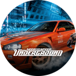

<a id="readme-top"></a>

<div align="center">



<h3 align="center">NFSUG1VITA</h3>

<p align="center">
  <b>Need for Speed Underground, on the PS Vita</b>
  <br />
  <br />
  A fan port of the PC version of Need for Speed Underground (2003, US and European versions)
  <br />
  <br />
  <a href="#install">Install</a>
  &nbsp;·&nbsp;
  <a href="#controls">Controls</a>
  &nbsp;·&nbsp;
  <a href="#settings">Settings</a>
  &nbsp;·&nbsp;
  <a href="../../issues">Report Bug</a>
</p>

[![build][build-shield]][build-url]&nbsp;[![issues][issues-shield]][issues-url]&nbsp;[![last commit][commit-shield]][commit-url]

[![platform][platform-shield]][platform-url]&nbsp;[![resolution][resolution-shield]][resolution-url]&nbsp;[![renderer][renderer-shield]][renderer-url]&nbsp;[![license][license-shield]][license-url]

</div>

> **Version 0.9, playtesting.** The game is being tested before the final release. It's worth the wait!

## Requirements

- Need for Speed Underground for PC, **US or European, version 1.4** (your own copy)
- The game's `Speed.exe` must have the **no-DVD patch** applied
- PS Vita with HENkaku / Ensō and [VitaShell](https://github.com/TheOfficialFloW/VitaShell)
- About 1.5 GB free on the memory card
- Overclocking is mandatory, for example with [PSVshell](https://github.com/Electry/PSVshell)
- [CapUnlocker](https://github.com/GrapheneCt/CapUnlocker) is highly recommended

## Install

1. Install `NFSUG1VITA.vpk` with VitaShell.
2. Create the folder `ux0:data/NFSUG1VITA/` in VitaShell (or start the game once; it creates the folder and closes).
3. On your PC, open the game folder (the one with `Speed.exe`) and copy **everything inside it** to
   `ux0:data/NFSUG1VITA/` (VitaShell's FTP or USB mode works). `Speed.exe` must end up at
   `ux0:data/NFSUG1VITA/Speed.exe`.
4. Start the game from the home screen.

If the game closes right away, `ux0:data/NFSUG1VITA/nfsug1vita.log` says what is missing.

## Controls

### Menus

| Button | Action |
|--------|--------|
|  | Move |
|  | Select |
|  | Back |
|  | Extra option on the screen (Customize, Stock, …) |
|  | Start, skip movie |

### Driving

| Button | Action |
|--------|--------|
|  | Accelerate |
|  | Brake / reverse |
|    | Steer |
|  | Nitrous |
|  | Handbrake |
|  | Look back |
|  | Change camera |
|  /  | Shift up / down |
| Rear touch, right / left | Shift up / down |
|  | Reset car to the track |
|  | Pause |

Text fields open the Vita keyboard (or  +
). To quit, use the PS button.

## Settings

Settings are optional. Create a text file `ux0:data/NFSUG1VITA/nfsug1vita.cfg` (not `nfsug1vita.cfg.txt`) with one
setting per line, for example:

```
menu_widescreen=off
```

| Setting | Values | What it does |
|---------|--------|--------------|
| `widescreen` | `on` (default), `off` | Full 16:9 picture, or the original 4:3 one |
| `fit_4_3` | `stretch` (default), `pillarbox` | With `widescreen=off`: stretch the 4:3 picture, or keep it with black bars |
| `menu_widescreen` | `on` (default), `off` | Menus laid out for the wide screen, or centred at 4:3 |
| `hud_widescreen` | `on` (default), `off` | Race HUD at the screen edges, or centred at 4:3 |
| `button_prompts` | `vita` (default), `pc` | Vita buttons on screen, or the original PC keys |
| `rear_touch` | `off` (default), `on` | Enable the rear touch pad for shifting; D-pad up/down still shifts with it off |
| `garage_camera` | `on` (default), `off` | Map the right stick to the car-orbit controls in Customize Ride and car-selection menus |
| `car_reflection_interval` | `1` (default) to `6` | Higher values update the car reflections less often, for more speed |

### This fork's control changes

Rear touch is disabled by default. D-pad **up** shifts up and **down** shifts down in drag races and with manual
transmission. D-pad navigation in menus is unchanged. **Options → Controller** has a **Rear Touch Pad** row below
Vibration. Select it with up/down, then use left/right to switch **On/Off**, just like Vibration. It uses an existing
native option row's font, arrows and selection styling, applies immediately, and saves `rear_touch` in
`nfsug1vita.cfg` without changing other settings. Enabling touch waits for fingers to lift before accepting a shift.
The row works with either PC or Vita button prompts. Square does not toggle rear touch.
Other settings are read at startup; the game's controls screen does not save custom pad bindings in this port.

Left-stick driving uses the Vita's calibrated analog value directly for the game's analog-steering event, with
an 8% radial dead zone and proportional response across the full range. D-pad steering retains its digital
priority. Returning from pause immediately accepts held throttle, brake and steering; menu confirmation, pause
and shift buttons still wait for release to prevent unintended actions.

A ready-to-copy [settings file](examples/nfsug1vita.cfg) disables rear touch. Copy it to
`ux0:data/NFSUG1VITA/nfsug1vita.cfg`, or merge its settings into an existing file without duplicating keys.

The right stick is mapped to the game's existing four car-orbit actions in the front end. It has a radial dead
zone and proportional speed (62.5% faster than the first camera test), and releasing the stick sends a stop event. The camera mapping is disabled during
races, pause menus and text entry; the race's combined-pedal axis stays centred. Set `garage_camera=off` to
disable stick-controlled orbiting. The first build's orbit controls were confirmed working on the Vita;
the increased speed still needs a device check.

Control checks on macOS/Linux: `sh tools/test-controls.sh` (set `VITASDK` if the SDK is not in `.deps/vitasdk`).
These simulate pad/touch samples and check D-pad shifts, live rear-touch changes, config persistence and failure,
camera directions and speed, the native third row and arrows, and preservation of the existing two row handlers.
`python3 tests/camera_game_test.py binaries/Speed.exe` also exercises the original game's joystick-mask builder
and camera event scanners using your own executable (requires `unicorn==2.1.4`, which can be installed into
`.pydeps`). It checks all four directions, proportional movement, diagonal input and release events.
`python3 tests/controls_menu_game_test.py binaries/Speed.exe` executes the original Controller entry route,
row visibility/enabling helpers, arrow helpers, and Options notification dispatch for all three rows.
`python3 tests/driving_game_test.py binaries/Speed.exe` checks all 256 steering levels in the original driver,
fractional steering angles, d-pad priority, and the held-throttle event on return from a menu.
Before releasing a custom VPK, test garage rotation in both
directions, neutral-stick drift, race/pause transitions, D-pad shifts in a drag race, and the native row's
appearance and saved on/off state after a restart on the Vita.

Control feature requests and PS Vita hardware testing: [KoreanSeats1](https://github.com/KoreanSeats1).

### Corrupted car reflections

This branch includes upstream's `d1a482f` fix from
[playtest-hotfix](https://github.com/NDRWhun/UG1VITA/releases/tag/playtest-hotfix). It corrects the GPU offsets for the
single-level cube texture used by car reflections.

The [current Vita Alive entry](https://github.com/VegettoSan/PSVitaAlive/blob/main/apps/need-for-speed-underground.json)
distributes Hotfix 2. Its downloaded `eboot.bin` and `glyphs.bin` match the official Hotfix 2 release byte-for-byte
(checked November 19, 2026). Updating to the current Vita Alive version resolved the reported purple/white car
reflections during races and customization. No additional renderer change is needed for that report. The
washed-out garage background is a separate known issue.

## Known issues

- A few frames drop below 30 fps in busy moments of a race.
- The 3D garage behind some menus can look washed out.
- No online or LAN play.
- There are some issues with EU Region versions due to shifted addresses. It's being investigated now. 

## Build

Requirements: [Python 3](https://www.python.org/downloads/) and PowerShell (part of Windows). Everything else is
downloaded on the first build: [VitaSDK](https://vitasdk.org) and [LLVM](https://llvm.org) into `.deps/`, CMake and
Ninja with pip. To use your own VitaSDK or LLVM, set `VITASDK` or `NFSU_LLVM` (or put them in `tools/env.local.ps1`).

```powershell
tools/build.ps1 -Game "<folder with Speed.exe>"   # -> build-release-clang/NFSUG1VITA.vpk
```

- The recompiled code is generated from your own `Speed.exe`; no game code or data is in this repository.
- Shaders ship prebuilt in `shaders/gxp/`.
- The build options are described at the top of `tools/build.ps1`.

| Path | Contents |
|------|----------|
| `include/` | virtual x86 CPU, runtime, Win32 and platform headers |
| `src/lib/` | runtime: guest memory, threads, Win32, C runtime, Direct3D 9 and D3DX |
| `src/platform/` | Vita backend: GXM renderer, audio, input, sync, logging |
| `src/nfsu/` | entry point, native replacements of game functions |
| `shaders/` | Cg shaders and compiled binaries |
| `tools/` | recompiler and build scripts |

## Credits

- [Grarak](https://github.com/Grarak): [psp2-tooling](https://github.com/Grarak/psp2-tooling) and
  [mh3-wii](https://github.com/Grarak/mh3-wii)
- [GrapheneCt](https://github.com/GrapheneCt): CapUnlocker
- EA Black Box: *Need for Speed Underground*

## License

MIT for the port's own code ([LICENSE](LICENSE)); third-party parts: [THIRD_PARTY.md](THIRD_PARTY.md).

Unofficial, non-commercial fan port, not affiliated with or endorsed by Electronic Arts. *Need for Speed* is a
trademark of Electronic Arts. You must own the game.

<!-- BADGES -->

[build-shield]: https://img.shields.io/github/actions/workflow/status/NDRWhun/UG1VITA/build.yml?branch=main&label=build&style=for-the-badge&labelColor=1a1f3d&logo=githubactions&logoColor=white
[build-url]: ../../actions/workflows/build.yml
[issues-shield]: https://img.shields.io/github/issues/NDRWhun/UG1VITA?label=issues&style=for-the-badge&labelColor=1a1f3d&color=2f7bff&logo=github&logoColor=white
[issues-url]: ../../issues
[commit-shield]: https://img.shields.io/github/last-commit/NDRWhun/UG1VITA?label=updated&style=for-the-badge&labelColor=1a1f3d&color=ff3b5c
[commit-url]: ../../commits/main
[platform-shield]: https://img.shields.io/badge/PS%20Vita-native-2f7bff?style=for-the-badge&labelColor=1a1f3d&logo=playstation&logoColor=white
[platform-url]: https://vitasdk.org
[resolution-shield]: https://img.shields.io/badge/960x544-native-b44dff?style=for-the-badge&labelColor=1a1f3d
[resolution-url]: #settings
[renderer-shield]: https://img.shields.io/badge/renderer-sceGxm-ff3b5c?style=for-the-badge&labelColor=1a1f3d
[renderer-url]: #build
[license-shield]: https://img.shields.io/badge/license-MIT-ff3b5c?style=for-the-badge&labelColor=1a1f3d
[license-url]: LICENSE
